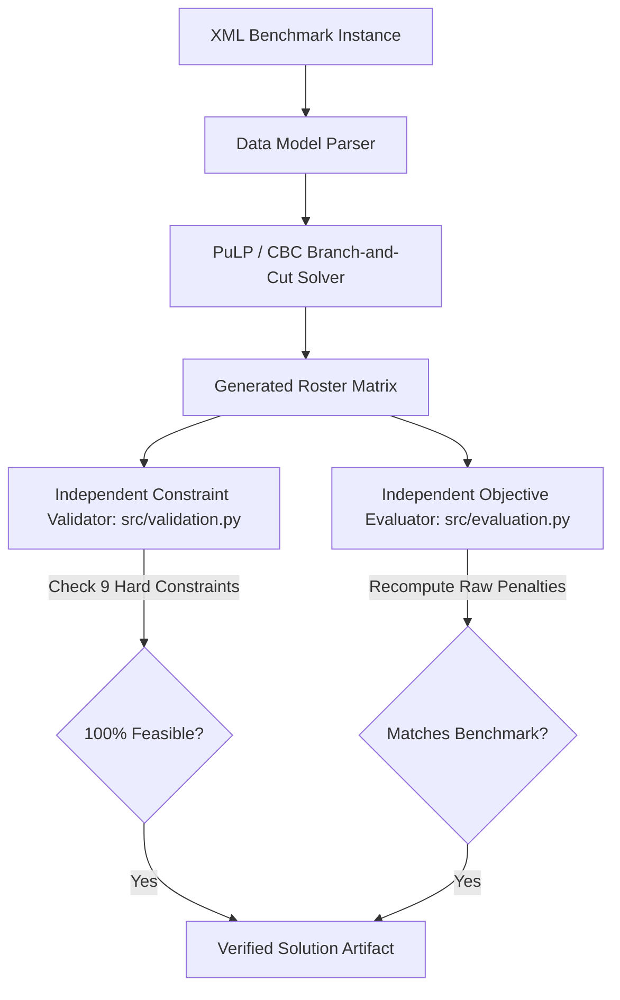

# Benchmark-Grade Nurse Rostering Decision-Support System
### Exact Integer Programming & Multi-Criteria Goal Programming Formulations for the International Nurse Rostering Benchmark (NRP)

[](https://github.com/kamaladhi/nurse-rostering-or/actions/workflows/tests.yml)
[](https://www.python.org/downloads/)
[-brightgreen.svg)](docs/RESULTS.md)
[-orange.svg)](https://github.com/coin-or/Cbc)
[](LICENSE)

---

## Abstract

The **Nurse Rostering Problem (NRP)** is a combinatorial optimization challenge characterized by tight multi-period coverage requirements, complex ergonomic rest constraints, heterogeneous employment contracts, and conflicting individual shift requests. 

This repository provides a **computational benchmark and Decision Support System (DSS)** built upon the canonical international NRP benchmark instances established by Curtois, Qu, and Vanden Berghe ([schedulingbenchmarks.org/nrp](https://www.schedulingbenchmarks.org/nrp/)). 

### Key Contributions
1. **Provably Optimal Formulation:** The Mixed-Integer Linear Programming (MIP) model **reproduces published global optima with exactly 0.00% optimality gap** across all evaluated benchmark instances (Instances 1–4) under the open-source COIN-OR Branch-and-Cut (CBC) solver.
2. **Multi-Criteria Goal Programming (MCGP):** A soft-goal formulation incorporating an explicit **workload equity target** to analyze the fundamental Pareto trade-off between institutional understaffing penalties and staff fairness.
3. **Closed-Form Phase-Transition Analysis:** Mathematical derivation and empirical validation of the exact parametric switch point ($w_4^* = 100/480 \approx 0.2083$) governing staff equity versus staffing coverage.
4. **Cryptographic Model Invariance & Independent Validation:** A dual-layer audit architecture including an independent constraint validator (`src/validation.py`), objective re-evaluator (`src/evaluation.py`), and SHA-256 LP bytecode fingerprinting ensuring zero formulation drift.
5. **Interactive Operations Research DSS:** An 8-page Streamlit decision cockpit providing exploratory data analysis, real-time branch-and-bound telemetry, dual-model comparative analytics, and interactive roster matrices.

---

## 1. Benchmark Instance Topology & Dimensions

The benchmark instances feature diverse organizational structures, planning horizons, shift lengths, and contract rules. All instances are parsed directly from official XML (`.ros`) definitions without manual preprocessing.

| Instance | Horizon | Staff Count | Shift Types | Contracts | Shift Requests | Required Shifts | Contract Capacity | Structural Balance | Decision Variables | Constraints |
|---|---|---|---|---|---|---|---|---|---|---|
| **Instance 1** | 14 days | 8 nurses | 1 (Early) | 1 (Full-Time) | 16 | 77 | 72 | $-5$ (Deficit) | 260 | 493 |
| **Instance 2** | 14 days | 14 nurses | 2 (Early, Late) | 3 (FT, 80%, PT) | 59 | 118 | 114 | $-4$ (Deficit) | 730 | 1,475 |
| **Instance 3** | **14 days** | **20 nurses** | **3 (Early, Day, Late)** | **3 (FT, 80%, PT)** | **64** | **154** | **155** | **$+1$ (Surplus)** | **1,308** | **2,547** |
| **Instance 4** | 28 days | 10 nurses | 2 (Early, Late) | 1 (Full-Time) | 39 | 187 | 180 | $-7$ (Deficit) | 1,073 | 2,139 |

> **Analytical Note on Instance 3:** While nominal shift capacity ($155$) marginally exceeds demand ($154$), structural infeasibility emerges from the simultaneous intersection of hard ergonomic minimum rest ($840$ minutes), maximum consecutive working shifts, weekend limits, and fixed days off. As proven below, a minimum of $10$ nurse-shifts are mathematically impossible to fill under the hard constraints.

---

## 2. Mathematical Formulations

### 2.1 Sets, Indices, and Parameters

* **Sets:**
  * $n \in N$: Set of nurses ($|N| \in [8, 20]$).
  * $d \in D = \{1, \dots, |D|\}$: Planning horizon days ($|D| \in \{14, 28\}$).
  * $s \in S$: Shift types (Early $E$, Day $D$, Late $L$, Night $N$).
  * $w \in W$: Set of 2-day calendar weekends $(\text{Saturday}_w, \text{Sunday}_w)$.
  * $i \in I_{\text{on}}, j \in I_{\text{off}}$: Sets of explicit ShiftOn and ShiftOff personal preferences.
* **Parameters:**
  * $R^{\min}_{d,s}, R^{\max}_{d,s}$: Required lower and upper staffing bounds for shift $s$ on day $d$.
  * $c^{\min}_{d,s}, c^{\max}_{d,s}$: Benchmark unit penalties for understaffing and overstaffing ($c^{\min} = 100$, $c^{\max} = 1$).
  * $a_i, b_j$: Benchmark penalty weights for violating request $i \in I_{\text{on}}$ or $j \in I_{\text{off}}$.
  * $L_s$: Shift duration in minutes ($L_s = 480\text{ min}$ for standard 8-hour shifts).
  * $[\text{MinWL}_n, \text{MaxWL}_n]$: Contractual cumulative workload bounds (in minutes).
  * $M_n$: Maximum permitted consecutive working days.
  * $K_n$: Maximum permitted working weekends in the horizon.

---

### 2.2 Model 1: Integer Programming (Benchmark Formulation)

#### Decision Variables
* $x_{n,d,s} \in \{0, 1\}$: Binary variable equal to $1$ if nurse $n$ works shift $s$ on day $d$.
* $y_{n,d} \in \{0, 1\}$: Auxiliary binary variable equal to $1$ if nurse $n$ works any shift on day $d$.
* $z_{n,w} \in \{0, 1\}$: Binary weekend indicator equal to $1$ if nurse $n$ works any shift during weekend $w$.
* $u_{d,s}, o_{d,s} \ge 0$: Integer slack variables measuring understaffing and overstaffing on day $d$, shift $s$.
* $v^{\text{on}}_i, v^{\text{off}}_j \in \{0, 1\}$: Binary indicators for violated shift requests.

#### Objective Function
Minimizes the benchmark penalty function $Z_{\text{IP}}$:

$$
\min Z_{\text{IP}} = \sum_{d \in D} \sum_{s \in S} \left( c^{\min}_{d,s} \cdot u_{d,s} + c^{\max}_{d,s} \cdot o_{d,s} \right) + \sum_{i \in I_{\text{on}}} a_i \cdot v^{\text{on}}_i + \sum_{j \in I_{\text{off}}} b_j \cdot v^{\text{off}}_j
$$

#### Hard Operational & Ergonomic Constraints

1. **Single Shift Per Day:**
   $$\sum_{s \in S} x_{n,d,s} = y_{n,d} \le 1, \quad \forall n \in N, d \in D$$

2. **Shift Eligibility:**
   $$x_{n,d,s} = 0, \quad \forall (n, s) \notin \text{AllowedShifts}(n)$$

3. **Fixed Leave / Days Off:**
   $$y_{n,d} = 0, \quad \forall (n, d) \in \text{FixedDaysOff}(n)$$

4. **Contractual Workload Bounds:**
   $$\text{MinWL}_n \le \sum_{d \in D} \sum_{s \in S} L_s \cdot x_{n,d,s} \le \text{MaxWL}_n, \quad \forall n \in N$$

5. **Ergonomic Minimum Rest Hours ($\ge 840$ minutes):**
   $$x_{n,d,s_1} + x_{n,d+1,s_2} \le 1, \quad \forall (s_1, s_2) \in \text{IncompatiblePairs}, \forall n \in N, d \in \{1, \dots, |D|-1\}$$
   *(Forbids Late → Early [480 min rest], Late → Day [660 min rest], and Day → Early [780 min rest]).*

6. **Maximum Consecutive Working Days:**
   $$\sum_{\tau=0}^{M_n} y_{n, d+\tau} \le M_n, \quad \forall d \in \{1, \dots, |D| - M_n\}, \forall n \in N$$

7. **Weekend Assignment Coupling:**
   $$z_{n,w} \ge y_{n,\text{Sat}_w}, \quad z_{n,w} \ge y_{n,\text{Sun}_w}, \quad z_{n,w} \le y_{n,\text{Sat}_w} + y_{n,\text{Sun}_w}, \quad \sum_{w \in W} z_{n,w} \le K_n$$

8. **Coverage Soft Goal Linking:**
   $$\sum_{n \in N} x_{n,d,s} + u_{d,s} - o_{d,s} = R^{\min}_{d,s}, \quad \forall d \in D, s \in S$$

9. **Request Soft Goal Linking:**
   $$x_{n,d,s} + v^{\text{on}}_i \ge 1, \quad \forall i \in I_{\text{on}}; \qquad x_{n,d,s} - v^{\text{off}}_j \le 0, \quad \forall j \in I_{\text{off}}$$

---

### 2.3 Model 2: Multi-Criteria Goal Programming (Fairness Formulation)

The Goal Programming model maintains **identical hard constraint feasibility** while formulating soft operational targets as goals with explicit deviational variables ($d^-, d^+$). It introduces an explicit **Staff Workload Equity Goal** ($G_3$) to balance shift burdens across nurses.

#### Goal Formulations
* **Goal 1 (Staffing Coverage):**
  $$\sum_{n \in N} x_{n,d,s} + d^-_{d,s} - d^+_{d,s} = R^{\min}_{d,s}, \quad \forall d \in D, s \in S$$

* **Goal 2 (Shift Preferences):**
  $$x_{n,d,s} + v^{\text{on}}_i \ge 1, \quad x_{n,d,s} - v^{\text{off}}_j \le 0$$

* **Goal 3 (Workload Equity Target):**
  $$\sum_{d \in D} \sum_{s \in S} L_s \cdot x_{n,d,s} + wp^-_n - wp^+_n = T_n, \quad \forall n \in N$$
  Where target $T_n = \frac{\text{MinWL}_n + \text{MaxWL}_n}{2}$ represents the contractual midpoint ($3840\text{ min}$ for full-time, $1680\text{ min}$ for part-time).

#### GP Objective Function

$$
\min Z_{\text{GP}} = w_1 \sum_{d,s} c^{\min}_{d,s} d^-_{d,s} + w_3 \sum_{d,s} c^{\max}_{d,s} d^+_{d,s} + w_2 \left(\sum_i a_i v^{\text{on}}_i + \sum_j b_j v^{\text{off}}_j\right) + w_4 \sum_{n \in N} \left(wp^-_n + wp^+_n\right)
$$

*Default Weights: $w_1 = 1.0, w_2 = 1.0, w_3 = 1.0, w_4 = 0.5\text{ penalty units / minute}$.*

---

## 3. Empirical Benchmark Verification & Optimality Proofs

The IP formulation was evaluated against published lower bounds ($LB$) and published best-known solutions ($BKS$) from the international NRP repository.

### 3.1 Optimality Verification Matrix

| Benchmark Instance | Published Lower Bound ($LB$) | Published Best-Known ($BKS$) | IP Objective ($Z^*_{\text{IP}}$) | CBC Solver Status | Proven Optimality Gap | Wall-Clock Solve Time |
|---|---|---|---|---|---|---|
| **Instance 1** | 607 | 607 | **607** | Proven Optimal | **0.00 %** | 0.81 s |
| **Instance 2** | 828 | 828 | **828** | Proven Optimal | **0.00 %** | 1.14 s |
| **Instance 3** | 1001 | 1001 | **1001** | Proven Optimal | **0.00 %** | 181.82 s |
| **Instance 4** | 1716 | 1716 | **1716** | Proven Optimal | **0.00 %** | 1.94 s |

#### Analytical Penalty Decomposition of Instance 3 Optimum ($Z^*_{\text{IP}} = 1001$)

$$
Z^*_{\text{IP}} = (10 \times 100) + (0 \times 1) + (1 \times 1) = 1001
$$

* **Coverage Deficit Penalty ($1000$):** $10 \text{ unfilled shifts} \times 100 \text{ unit penalty}$.
* **Overstaffing Penalty ($0$):** $0 \text{ excess shifts} \times 1 \text{ unit penalty}$.
* **Preference Penalty ($1$):** $1 \text{ ShiftOn request violation} \times 1 \text{ unit penalty}$.

Independent verification confirms that reducing unfilled shifts from $10$ to $9$ is mathematically infeasible without violating contractual rest rules or maximum shift quotas.

---

## 4. Multi-Criteria Benchmark Comparison (Pareto Analysis)

### 4.1 Axiomatic Comparability Principle
$Z_{\text{IP}}$ and $Z_{\text{GP}}$ operate on fundamentally non-commensurate scales. $Z_{\text{IP}}$ minimizes benchmark penalty units, whereas $Z_{\text{GP}}$ incorporates minute-based workload deviations weighted by $w_4$. Comparing raw objective magnitudes (e.g., $1001$ vs. $2000$) is mathematically invalid.
**The models must be compared component-by-component.**

### 4.2 Comprehensive Component-by-Component Benchmark

| Metric | Inst 1 (IP) | Inst 1 (GP) | Inst 2 (IP) | Inst 2 (GP) | Inst 3 (IP) | Inst 3 (GP) | Inst 4 (IP) | Inst 4 (GP) |
|---|---|---|---|---|---|---|---|---|
| **Solver Status** | Optimal | Optimal | Optimal | Optimal | Optimal | Optimal | Optimal | Optimal |
| **Unfilled Shifts ($d^-$)** | **6** | 7 | **8** | 12 | **10** | 14 | **17** | **17** |
| **Coverage Efficiency** | **92.21%** | 90.91% | **93.22%** | 89.83% | **93.51%** | 90.91% | **90.91%** | **90.91%** |
| **Request Violations** | **4** | 8 | 18 | **11** | 1 | **0** | **7** | 8 |
| **Workload Range (min)** | 960 | **0** | 2,400 | **1,920** | 2,400 | **1,920** | 960 | **0** |
| **Workload Std. Dev. (min)** | 358.6 | **0.0** | 868.1 | **778.6** | 930.8 | **831.4** | 339.4 | **0.0** |
| **Jain's Fairness Index ($\mathcal{J}$)** | 0.9900 | **1.0000** | 0.9252 | **0.9351** | 0.9324 | **0.9423** | 0.9984 | **1.0000** |

Where Jain's Fairness Index is computed over nurse shift minutes $x_n$:

$$
\mathcal{J}(x) = \frac{\left( \sum_{n \in N} x_n \right)^2}{|N| \cdot \sum_{n \in N} x_n^2}, \quad \mathcal{J} \in [0, 1] \quad (\mathcal{J}=1 \implies \text{perfect equality})
$$

### 4.3 Research Insights
1. **Coverage Supremacy of MIP:** In all instances, the Integer Program achieves the strict mathematical minimum understaffing.
2. **Workload Flattening in GP:** The Goal Program contracts the workload range (reaching perfect balance $\mathcal{J} = 1.0000$ on Instances 1 and 4).
3. **Preference Trade-Offs:** On Instance 3, GP satisfies 100% of nurse requests ($0$ violations vs. $1$ in IP), demonstrating how multi-criteria formulations can prioritize staff retention.

---

## 5. Parametric Sensitivity & Phase-Transition Analysis

To evaluate how staff fairness affects coverage, a parametric sweep of $w_4 \in [0.0, 1.0]$ was executed on Instance 3.

```text
       Understaffing Penalty (Coverage Deficit)
1400 ┼──────────────────────────────●─────●─────●  (GP Regime: Fair Workload, 14 Unfilled)
     │                              |
1200 ┼                              |
     │                              |  Critical Switch Threshold:
1000 ┼────●─────●─────●─────●       |  w4* = 100 / 480 ≈ 0.2083
     │                      |       |
 800 ┼──────────────────────┼───────┼─────────────────────────
     0.0   0.05  0.10  0.20  0.208 0.25  0.50  1.00    w4 (Workload Weight)
```

### 5.1 Analytical Proof of the Critical Switch Threshold ($w_4^*$)
* In the NRP formulation, an unfilled shift incurs penalty $c^{\min} = 100$.
* A nurse working one shift ($480\text{ min}$) away from target midpoint $T_n$ incurs deviational cost $480 \cdot w_4$.
* The solver trades off coverage for workload equity if and only if:
  $$480 \cdot w_4 > c^{\min} \implies w_4 > \frac{100}{480} \approx 0.20833$$

### 5.2 Empirical Parametric Validation Table

| Weight $w_4$ | Solver Status | Unfilled Shifts | Request Violations | Workload Range (min) | Workload Std. Dev. (min) |
|---|---|---|---|---|---|
| **$0.000$** | Proven Optimal | **10** | 1 | 2,400 | 930.8 |
| **$0.050$** | Proven Optimal | **10** | 1 | 2,400 | 930.8 |
| **$0.100$** | Proven Optimal | **10** | 1 | 2,400 | 930.8 |
| **$0.200$** | Proven Optimal | **10** | 1 | 2,400 | 930.8 |
| **$0.2083$** | **Phase Boundary** | **Regime Transition** | | | |
| **$0.250$** | Proven Optimal | 14 | **0** | **1,920** | **831.4** |
| **$0.500$ (Default)** | Proven Optimal | 14 | **0** | **1,920** | **831.4** |
| **$1.000$** | Proven Optimal | 14 | **0** | **1,920** | **831.4** |

---

## 6. Verification Architecture & Cryptographic Integrity

To ensure scientific reproducibility and guard against model drift, this project implements a strict verification pipeline:



### 6.1 Cryptographic LP Model Fingerprinting
Every release is tested against pinned SHA-256 signatures of generated LP constraint matrices (`tests/test_model_unchanged.py`):
* **IP Model Signature (Instance 3):**
  * Variables: `1,308` | Constraints: `2,547`
  * SHA-256: `7131d5649dfa2c0212d014a87d34a3d5dbb55d1b1d758e7fa5541d79ad0a050d`
* **GP Model Signature (Instance 3):**
  * Variables: `1,348` | Constraints: `2,525`
  * SHA-256: `a0f8a8bc08fc161de7004a9e28dc3bf93e2b6cd96f7dc79b7806c0a21e6beae5`

---

## 7. Decision Support System Architecture

The application is deployed as a modular multi-page Streamlit DSS (`app.py`), engineered according to Operations Research decision-support standards:

```text
app.py (Streamlit Master Navigation)
├── 1. Dataset Explorer      ── XML loading, schema validation, compatibility diagnostics
├── 2. Statistics Cockpit    ── Demand distributions, contractual capacity vs demand, requests
├── 3. Model Formulations   ── Mathematical equations, sets, bounds, and parameters
├── 4. Optimization Engine   ── Live solver execution, time limit controls, GP weight tuning
├── 5. Solution Results      ── Solve status, branch-and-cut proof, objective breakdown
├── 6. Analytics & Charts    ── Workload histograms, daily coverage profiles, request fulfillment
├── 7. Comparative Analysis  ── Component-by-component IP vs GP radar and metric tables
└── 8. Interactive Roster    ── Shift calendar matrix, nurse schedules, and CSV export
```

### Visual Roster Output & Comparative Analytics
* **Roster Matrix:** Visual allocation of Early, Day, and Late shifts across 20 nurses and 14 days (`docs/images/roster_ip_instance3.png`).
* **Radar & Pareto Comparisons:** Comparative visualizations detailing the coverage versus equity trade-off (`docs/images/ip_vs_gp_instance3.png`).

---

## 8. Computational Environment & Reproducibility

### 8.1 Experimental Environment
* **Platform:** Windows 11 / Linux (Ubuntu 22.04 LTS tested in CI)
* **Runtime:** Python 3.10+ (64-bit)
* **Optimization Framework:** PuLP 2.8+
* **Underlying Solver:** COIN-OR CBC 2.10.x
* **Execution Mode:** Single-threaded execution (`threads=1`). Multi-threaded CBC cut-generation exhibited thread contention on dense MIP cuts; single-threaded execution guarantees deterministic branch-and-bound trajectories.

### 8.2 Execution Protocol

#### 1. Setup Virtual Environment
```bash
# Windows
run_app.bat

# macOS / Linux
python -m venv .venv
source .venv/bin/activate
pip install -r requirements.txt
```

#### 2. Run Comprehensive Test Suite (116 Tests)
```bash
# Fast regression test suite (< 3 seconds)
python -m unittest discover -s tests -t .

# Full test suite including live solver optimality proofs
run_tests.bat slow
# Or via environment variable on Linux/macOS:
RUN_SLOW_TESTS=1 python -m unittest discover -s tests -t .
```

#### 3. Reproduce All Reference Solutions and Experiments
```bash
# 1. Solve all benchmark instances and save certified rosters
python scripts/generate_reference_solutions.py --time-limit 900

# 2. Recompute cross-model comparison JSON and summary CSVs
python scripts/generate_comparison_reports.py

# 3. Re-run empirical parametric sensitivity analysis
python scripts/gp_weight_sensitivity.py

# 4. Launch the Decision Support System
streamlit run app.py
```

---

## 9. References & Benchmark Citations

If you utilize this benchmark codebase, formulations, or results in academic research, please cite:

```bibtex
@article{curtois2014computational,
  title={Computational results for the nurse rostering benchmark instances},
  author={Curtois, Timothy and Qu, Rong},
  journal={School of Computer Science, University of Nottingham, Technical Report},
  year={2014},
  url={https://www.schedulingbenchmarks.org/nrp/}
}

@article{burke2004state,
  title={The state of the art of nurse rostering},
  author={Burke, Edmund K and De Causmaecker, Patrick and Vanden Berghe, Greet and Van Landeghem, Hendrik},
  journal={Journal of Scheduling},
  volume={7},
  number={6},
  pages={441--499},
  year={2004},
  publisher={Springer}
}

@article{forrest2005cbc,
  title={CBC user guide},
  author={Forrest, John and Lougee-Heimer, Robin},
  journal={Emerging theory, methods, and applications},
  pages={257--277},
  year={2005},
  publisher={INFORMS}
}
```

---

## 10. Repository License & Data Attribution
* **Codebase:** Distributed under the [MIT License](LICENSE).
* **Benchmark Instances:** Curtois & Qu (NRP Benchmark Repository). Distributed for non-commercial scientific research.
