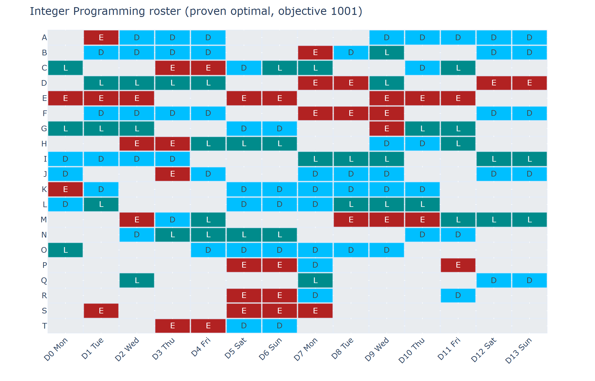
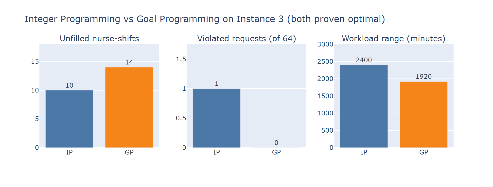
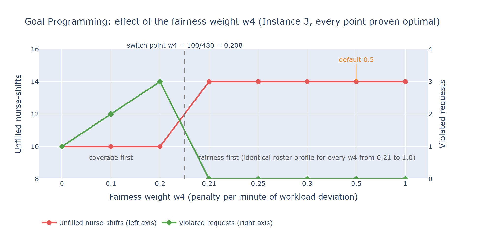

# Hospital Nurse Rostering - Operations Research Decision-Support System

[](https://github.com/kamaladhi/Operational-research-/actions/workflows/tests.yml)

An interactive Streamlit application that loads a public **Nurse Rostering Benchmark** instance, reports
descriptive statistics on demand, and builds nurse rosters with **two Operations Research models**:

| # | Model | Syllabus topic | Objective |
|---|---|---|---|
| 1 | **Integer Programming** | Integer programming models | The benchmark's own penalty objective |
| 2 | **Goal Programming** | Multicriteria decision making - goal programming | Weighted deviations from coverage, request and workload-fairness goals |

Dataset: **Nurse Rostering Benchmark Instance 3** (20 nurses, 14 days, 3 shift types) from
<https://www.schedulingbenchmarks.org/nrp/> - plus Instances 1, 2 and 4 as extra bundled samples.
Solver: **CBC** through **PuLP** (single-threaded, no licence needed).

---

## Headline results (all verified - see `docs/RESULTS.md`)

| Instance | Nurses x days | Published optimum | **IP objective** | IP status | IP gap | GP objective (not comparable) |
|---|---|---|---|---|---|---|
| Instance 1 | 8 x 14  | 607  | **607**  | proven optimal | 0 % | 716  |
| Instance 2 | 14 x 14 | 828  | **828**  | proven optimal | 0 % | 1694 |
| **Instance 3** | **20 x 14** | **1001** | **1001** | **proven optimal** | **0 %** | **2000** |
| Instance 4 | 10 x 28 | 1716 | **1716** | proven optimal | 0 % | 2021 |

* The Integer Programming model **reproduces the published, proven optimum on every bundled instance** -
  strong evidence that the formulation is faithful to the benchmark.
* The two models are **not comparable by raw objective** (the GP contains a workload-fairness term the
  benchmark does not have); they are compared component by component. On Instance 3 the IP leaves 10
  nurse-shifts unfilled (the unavoidable minimum) and breaks 1 request; the GP leaves 14 unfilled,
  breaks no request and narrows the workload range from 2400 to 1920 minutes.
* Solver status is reported honestly: **"Optimal" only when CBC proved it**; a run stopped by the time limit
  is shown as "Feasible, not proven optimal".

### Selected figures (Instance 3)



*Integer Programming roster: nurse x day, coloured with the shift colours defined in the XML.*



*The two models compared on the components they share (their raw objectives are on different scales).*



*Goal Programming: the fairness weight w4 has a single switch point at 100/480 = 0.208 (details in `docs/GOAL_PROGRAMMING.md`).*

## Quick start

Python 3.10 or newer is required.

**Windows**

```
run_app.bat            # first run creates .venv and installs requirements.txt, then opens the app
```

**macOS / Linux** (or Windows without the batch file)

```
python -m venv .venv
source .venv/bin/activate          # Windows: .venv\Scripts\activate
pip install -r requirements.txt
streamlit run app.py
```

Demo path (about 2 minutes): **Dataset** -> *Load sample* (Instance 3) -> **Statistics** (pick a statistic) ->
**Optimization** -> *Load saved reference solution* for IP and GP (instant) or press *Run* (IP needs ~2-3 min to
prove optimality on Instance 3; Instances 1-2 solve in ~1 s) -> **Results** -> **Comparison** -> **Roster**.
Full walkthrough: `docs/USER_GUIDE.md`.

## How the project meets the course guidelines

| Requirement | Where |
|---|---|
| Publicly available dataset | NRP benchmark instances (`data/raw/`, provenance in `data/raw/README.md`) |
| User interface through which data can be loaded | **Dataset** page: upload an XML/ROS file or load a bundled sample; parser diagnostics shown |
| Statistics generated on demand | **Statistics** page: choose Overview / Staffing demand / Nurses & contracts / Requests / Data tables - 10 charts + tables + CSV download |
| At least two optimisations, chosen by the user | **Optimization** page: Integer Programming and Goal Programming, each with its own *Run* button, time limit (and GP goal weights) |
| Course techniques | Integer programming; goal programming (weighted deviation variables) - both written out on the **Model** page |
| Results and comparison | **Results**, **Visualizations**, **Comparison**, **Roster** pages |

## The two models are unchanged

`tests/test_model_unchanged.py` pins a fingerprint (variables, bounds, every constraint, objective) of both
models, taken from the original code. The polishing work (status reporting, UI, statistics, tests, docs) did not
change either formulation - the original and the final code generate byte-identical LP files.

## Project structure

```
app.py                        Streamlit application (8 pages)
requirements.txt, run_app.bat, run_tests.bat
.github/workflows/tests.yml   continuous integration: runs the fast test suite on every push
src/
  parser.py, data_model.py    XML -> dataclasses (+ compatibility diagnostics)
  tables.py                   dataclasses -> pandas DataFrames / CSV
  data_statistics.py, stat_charts.py    on-demand statistics and their charts
  integer_program.py          MODEL 1 - Integer Programming        (formulation unchanged)
  goal_program.py             MODEL 2 - Goal Programming           (formulation unchanged)
  solver_utils.py             honest CBC status (proven optimal vs time-limited)
  validation.py               independent hard-constraint checker
  evaluation.py               independent recomputation of both objectives from a roster
  benchmarks.py               published values of instances 1-8, instance identification
  reference_solutions.py      saved verified solutions (re-validated on load)
  comparison.py, reporting.py, visualization.py   comparison metrics, result tables, solution charts
data/raw/                     Instance1-4.xml, nrp.html (benchmark page)
data/processed/               structured CSV tables per instance
results/                      reference solutions, comparison JSON/CSV, GP weight-sensitivity study
scripts/                      generate_reference_solutions.py, gp_weight_sensitivity.py,
                              generate_comparison_reports.py, export_tables.py
tests/                        117 automated tests (unit, model-regression, solver, UI)
docs/                         documentation: start at docs/README.md (index) - models, results, user guide,
                              viva guide, requirements/architecture, Final_Report.docx, images/
```

Data: the benchmark instances are by Curtois & Qu (<https://www.schedulingbenchmarks.org/nrp/>) and are used
unmodified; provenance is in `data/raw/README.md`.

## Reproducing the results

```
python scripts/generate_reference_solutions.py     # solve both models, prove optimality, save rosters   (~6 min)
python scripts/generate_comparison_reports.py      # results/*.json + summary.csv/md
python scripts/gp_weight_sensitivity.py            # GP weight study (docs/GOAL_PROGRAMMING.md)      (~7 min)
python scripts/export_tables.py                    # data/processed/*.csv
run_tests.bat slow                                  # all 117 tests including the live Instance 3/4 solves
python -m unittest discover -s tests -t .           # fast suite on any OS (set RUN_SLOW_TESTS=1 for the slow solves)
```

Solve times depend on the machine; the reported ones were measured on a 16-core Windows 11 PC with several solves
running in parallel (each solve itself is single-threaded).

## Limitations

* A benchmark, not live hospital data: no skills, departments, leave rules or legal regulations.
* Sequence rules at the horizon boundary follow the benchmark convention (blocks touching the boundary are
  exempt); weekends assume the horizon starts on a Monday (true for all official instances - the parser warns otherwise).
* The Goal Programming model is a weighted-sum goal program, not a pre-emptive (lexicographic) one; its default
  fairness weight is a modelling choice whose effect is quantified in the sensitivity study.
* Instances 5-8 load and solve but are not bundled: within 240 s the IP reached 1150 (optimum 1143) and 1955
  (optimum 1950) on Instances 5 and 6 - feasible and valid, not proven optimal.

See `docs/` for the full documentation and `docs/Final_Report.docx` for the written report.
